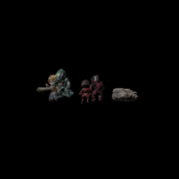

# ARE SoftwareGPU Engine

> **ARE SoftwareGPU Research & Leaderboard:** [Forschungswebsite mit CPU-Ranglisten öffnen](https://project25966.websitepublisher.ai/index.html) · [Original-Receipts & technische Ranglisten](docs/CPU_WAVE_RANGLISTEN.md) · [GitHub Actions](https://github.com/OuroborosCollective/ARE-SOFTWAREGPU-ENGINE/actions)
>
> Die öffentliche Website liest bestehende, revisionsgebundene CPU-Evidence aus diesem Repository. Historische Werte sind keine Live-FPS; neue Rekorde erfordern reale, geprüfte Benchmark-Receipts. Kein VPS-Zugriff durch die Website.

## Linux / Windows: öffentliche Python-Paketinstallation (in Vorbereitung)

Die CPU-only-Python-Engine hat einen separaten öffentlichen PyPI-Veröffentlichungspfad
[`ouroboroscollective-softwaregpu`](docs/PYPI_PACKAGE.md); der importierbare
API-Name bleibt `software_gpu`, der CLI-Befehl `software-gpu`.
**Nach erstmalig bestätigtem PyPI-Registry-Readback** lautet die Installation
`python -m pip install ouroboroscollective-softwaregpu` (Python 3.11/3.12).
Vorher ist der [Quellcode-Schnellstart](docs/QUICKSTART.md) der verifizierte Weg.
Die `[jit]`-Option nutzt optional Numba; die native C++17-Rasterizer-Binärdatei
ist nicht Teil dieses Wheels. Die separate npm-/Node-Gradio-Vorschau installiert
keine Engine. Jede SemVer-Veröffentlichung benötigt erfolgreiche exakte
GitHub-CI inkl. Linux-/Windows-Wheel-Installation und PyPI Trusted Publisher;
ein grüner Workflow ist noch keine bestätigte Veröffentlichung.
Die **PolyForm-Noncommercial-Lizenz** und `Required Notice` bleiben erhalten.
Die neuen Tests sind [neueste zuerst registriert](docs/CPU_WAVE_RANGLISTEN.md),
ohne erfundene Leistungswerte.

## Offline cost calibration (Issue #286, experimental)

The existing SurfacePlanner/PreparationCache now has a *separate* offline cost calibration candidate: four same-VertexColorShader scan/scalar/batch/no-scan A/B paths, 15 interleaved pairs per scene, disjoint holdout geometry, independent RGBA8/Float32-depth SHA and source/CPU provenance. Frozen SHA-bound policy replay is opt-in only; `tiles` remains the default and no unverified runtime or FPS benefit is claimed. See [cost calibration, tests and deployment boundaries](docs/ISSUE286_COST_CALIBRATION.md). The [new registered test series](docs/CPU_WAVE_RANGLISTEN.md) is not a performance rank. Use `python -m unittest software_gpu.tests.test_surface_cost_calibration -v` for negative contracts.

## GLB2 import copies and resource lifetime (Issue #293; 21 November 2026)

The existing GLB container preflight now avoids an unnecessary full BIN copy
using a read-only `memoryview`; native AREMDL03 still rejects multi-mesh assets.
A separate real-code 15-pair A/B **microbenchmark** captures source SHA,
CPU affinity, raw timings, allocation peaks and failed/accepted input boundaries.
Synthetic GLB stress fixtures are labelled as such, not presented as Owner
assets or end-to-end draw evidence. A real one-mesh CPU draw and 100 release
cycles are separately covered; there is no universal speedup, FBX exporter,
hardware GPU or FPS claim.

[Architecture, supported/unsupported boundaries and reproduction](docs/ISSUE293_GLB_IMPORT_RESOURCES.md)
· [Test series registry](evidence/test-series-catalog-v1.json)
· [CPU leaderboard (newest tests, no microbenchmark rank)](docs/CPU_WAVE_RANGLISTEN.md).

## glTF 2.1 / GLB v3: opt-in Inspektions-Sandbox (20. November 2026, Entwurf)

**glTF 2.1 und der 64‑Bit-Container „GLB v3“ sind nicht ratifiziert.** Gelesen am 20.11.2026: Die [Khronos-Registry](https://registry.khronos.org/glTF/) nennt weiterhin 2.0 als aktuelle Version, der 2.1‑Text liegt nur auf dem Arbeitsbranch `draft-2.1`, das [Tracking-Issue](https://github.com/KhronosGroup/glTF/issues/2585) ist offen. Der [vollständige Readback](evidence/gltf21-glb3-khronos-status-20261120.json) hält Quellen und Hashes fest.

Deshalb gibt es nur eine **getrennte, read-only Diagnose** hinter der Vertragskennung `are.gltf21-glb3-sandbox.v1`: `python -m tools.gltf21_glb3_sandbox ENTWURF.glb --contract are.gltf21-glb3-sandbox.v1`. Sie prüft Framing, 64‑Bit-Längen, JSON, Buffer-Grenzen und Budgets fail-closed, entpackt und lädt nichts und lässt kein Asset für den Renderer zu. Der GLB‑2.0‑Standardpfad ist unverändert und lehnt v3-Dateien weiterhin ab. [Vertrag, Regeln und Grenzen](docs/GLTF21_GLB3_SANDBOX_20261120.md).

**Neue Testreihen (neueste zuerst in der [Rangliste](docs/CPU_WAVE_RANGLISTEN.md)):** Sandbox-Vertrag, Python/C++17-Differenzial-Fuzzing und SHA-gepinnter Replay unabhängiger Khronos-Assets — `python -m unittest software_gpu.tests.test_gltf21_glb3_sandbox software_gpu.tests.test_gltf21_glb3_fuzz software_gpu.tests.test_gltf21_glb3_independent_assets -v`. Interoperabilität ist **nicht hergestellt**: Eine unabhängige Entwurfs-Implementierung richtet Chunks auf 4 statt 8 Byte aus. Keine Konformitäts-, Zeit- oder FPS-Aussage.

## Neue Testreihen zuerst · Visual Asset Lab (19. November 2026)

**Neue Tests erscheinen ab jetzt vor den historischen Ranglisten.** Die [CPU-Rangliste](docs/CPU_WAVE_RANGLISTEN.md) enthält oben einen automatisch aus [dem Testreihen-Katalog](evidence/test-series-catalog-v1.json) aufgebauten, nach Datum absteigend sortierten Abschnitt. Gleiche Daten werden stabil nach Test-ID sortiert. **Registriert** heißt nicht bestanden oder schneller: Ein neuer Leistungseintrag darf nur mit echten, vollständigen, SHA-gebundenen CPU-Messungen sowie RGBA-/Depth-Parität veröffentlicht werden. Bestehende historische Ergebnisse und ihre Semantik bleiben unverändert.

**Code Ontology Companion 0.6.0 – opt-in, statisch:** [Integrationsanleitung](docs/CODE_ONTOLOGY_COMPANION_20261119.md) · [isolierter GitHub-CI-Funktionstest](.github/workflows/code-ontology-companion.yml) · [Quelltest](software_gpu/tests/test_code_ontology_ci.py). Die neue Testreihe „Code Ontology: Suche, Impact und Diff“ steht wie vereinbart **neueste zuerst** in der [Rangliste](docs/CPU_WAVE_RANGLISTEN.md). Der CI-Prüflauf lädt das offizielle Release mit geprüftem SHA-256, analysiert echte ARE-Python-Symbole und testet Query/Impact/History/Sync sowie einen getrennten synthetischen Snapshot-Diff. Private Graphen werden nicht veröffentlicht, der native C++17-Kern ist nicht abgedeckt. **Statische Abhängigkeiten sind keine Runtime- oder FPS-Evidence.**

**Visual Asset Lab – opt-in, lokal, read-only:** `python -m tools.visual_asset_lab ORIGINAL.glb --output-dir /tmp/are-visual-asset`

Das Werkzeug erstellt `wireframe.svg`, bei vorhandenen UVs `uv.svg` und `visual-asset-receipt.json` aus **tatsächlichen GLB-BIN-Koordinaten**. Die Ansichten sind 2D-Strukturprojektionen, **kein** PBR-Beauty-Render; Material-URIs werden nicht geladen, die Asset-Qualität wird nicht erfunden und große/unsupported Eingaben werden geschlossen abgewiesen. Der erste Pilot begrenzt die Ansicht auf ein indiziertes Dreiecks-Primitive mit maximal 5000 Dreiecken – Originale mit Millionen Dreiecken benötigen einen separaten, gemessenen LOD-/Streaming-Pfad. [Details](docs/VISUAL_ASSET_LAB_20261119.md).

**Neue Regressionen:** `python -m unittest software_gpu.tests.test_visual_asset_lab software_gpu.tests.test_test_series_catalog -v`. Diese Tests sind noch **keine Performance-Messwerte**; ihren CI-Status zeigt der jeweilige GitHub-PR.

## Visual Asset Lab Phase 2: nativer PBR-Renderer, drei Diagnosen (21. November 2026)

**Opt-in, lokale CLI, keine zweite Renderer-Authority:** `python -m tools.visual_asset_lab_native privates-manifest.json --output-dir /privat/leer/are-pbr --pixels 64`. Der vorhandene C++17-`AREMDL03`-Worker erzeugt die echte Beauty-Ausgabe, die auf der nativen `resolved`-RGBA8-Ausgabe basiert, sowie den originalen Float32-Depthpuffer. JSON-Receipt enthält Quell-/Material-/Bild-/Build-SHAs, getrennte PNG-/BMP- und Framebuffer-Digests, gleiche Kamera und Bufferparität zwischen 1 und 2 Workern. Wireframe/UV-Naht sind ausdrücklich **nicht okklusionsgeprüfte, quellenbasierte Diagnosen**, keine neuen nativen Renderpasses. Native Schatten sind **nicht implementiert**. Unterschiedliche automatische LOD-Fits werden sichtbar als **nicht gleichwertig für visuellen LOD-Vergleich** markiert.

Nur SHA-gebundene lokale Original-GLBs, eingebettete Materialien/Bilder und unterstützte statische Einzel-Primitives; fremde Textur-URIs, Symlinks, überschreibbare Ausgaben und unsupported Eingaben werden abgelehnt. Kein HTTP/UI, keine Original-Asset-Veröffentlichung, keine Android-/Gameplay-FPS- oder Leistungsrang-Aussage. Owner-LOD-30k/12k/4k-Abnahme aus [Issue #103](https://github.com/OuroborosCollective/ARE-SOFTWAREGPU-ENGINE/issues/103) bleibt separat, bis echte private Quellen geprüft sind.

[CLI-Vertrag, Manifest, Einschränkungen](docs/VISUAL_ASSET_LAB_NATIVE_20261121.md) · [Neue lokale Native-Regression](software_gpu/tests/test_visual_asset_lab_native.py) · [Neueste Testreihe in der CPU-Rangliste](docs/CPU_WAVE_RANGLISTEN.md).

## KTX2/BasisU (Khronos v4.4.2), Texture-Residency und Learn-Weight-Audit (21. November 2026)

**Opt-in, offline und SHA-/Lizenz-gebunden:** `python -m tools.ktx2_texture_admission manifest.json --output-dir NEUER_ORDNER` verarbeitet eingebettetes KTX2/BasisU mittels **echtem, versions- und SHA-pinned Khronos KTX-Software-CLI** in einen klassischen PNG-GLB fuer den bestehenden C++17-PBR-Renderer. Ohne den verifizierten offiziellen Transcoder: **fail-closed**; keine zweite Raster-Authority. KTX2-Header/DFD, sRGB/Linear, Color Primaries, Mip-Index, Dimensionsbomben, Quelle/Lizenz/URI und Speicherbudgets je Textur und LOD werden vor der Decodierung geprueft. Nur Basis-Mip resident, keine freie Streaming-/Eviction-Behauptung.

**Learn-Weight-Routencheck:** alle sechs registrierten Raster-Backends erzeugen mit aktiviertem SQLite-Lerner reale Farb-/Float32-Tiefen- und Gewichtsevidenz. Bei sicheren Tile-Pfaden wird Referenz vs. Kandidat durch gespeicherte Gewichte gewaehlt; andere Backends nur beobachtet. H.264/FFV1-Export wird real geprueft; reine BMP/PPM-Serializer erben die gewichtete Eingabe. Native C++17 Modell-Probe, externe Blender-Engine und KTX-Konverter besitzen **keine eigene Gewichts-Auswahl**. Der Test klassifiziert diese Luecken ausdruecklich statt 100% aktive Gewichte zu behaupten. Keine neuen Performance-Raenge ohne 15 native gepaarte und qualitativ vergleichbare A/B-Messungen.

[Vertrag & Grenzen](docs/KTX2_BASISU_ADMISSION_20261121.md) · [Khronos-Regression](software_gpu/tests/test_ktx2_texture_admission.py) · [Learn-Weight-Audit](software_gpu/tests/test_learning_route_coverage.py) · [Testkatalog und Rangliste](docs/CPU_WAVE_RANGLISTEN.md).

## Weight-aware native and authoring outputs (21 November 2026)

Lokale, opt-in SQLite-Kalibrierung umfasst jetzt native AREMDL03-Modelle mit `workers='auto'`, Khronos KTX2/BasisU Extraktion, BMP/PPM-Byte-Exporte und delegierte Blender-/Aurion-/Asset-Lab-Receipts. Explizite Workerzahlen und Simulationstruth bleiben unveraendert. Tests pruefen echte Farb-/Float32-Tiefen- oder Ausgabebytes; bei Paritaetsfehlern wird der Kandidat gesperrt. [Tests](software_gpu/tests/test_learned_output_routes.py) · [Lernvertrag](docs/LOCAL_RENDER_LEARNING.md). Neue Testserie steht neueste zuerst im Katalog; keine unbelegten Leistungsränge.

## Verifizierter Stand – 9. November 2026

**Netzwerk-Rendering:** [PR #255](https://github.com/OuroborosCollective/ARE-SOFTWAREGPU-ENGINE/pull/255) ist mit Merge `01f2e00f7066d1d03428fa67fa81f329d0c5e4df` integriert. Der RPC-Dispatcher serialisiert das BMP jetzt mit `Framebuffer.to_bmp_bytes()` direkt im Speicher statt über temporäre Dateien; `save_bmp()` bleibt als kompatibler Datei-Export bestehen. Die Regressionen prüfen Bytegleichheit einschließlich nicht vierfach ausgerichteter Zeilenbreite. Auf dem geprüften PR-Head `c00b4e92887a51eedcdc71e66842384b16d402b7` waren **16/16 fachliche CI-Checks erfolgreich** (Linux/Windows, Python 3.11/3.12, Mesa, LLVM, NumPy-1.26, Renderparität und Netzwerk-Smoketests). [Exakte CPU-CI](https://github.com/OuroborosCollective/ARE-SOFTWAREGPU-ENGINE/actions/runs/42569879587) · [Mesa-CI](https://github.com/OuroborosCollective/ARE-SOFTWAREGPU-ENGINE/actions/runs/42569879572). Externe Code-Review-Dienste sind von dieser technischen CI-Aussage getrennt.

**Deterministische 128×128-Wellenforschung:** [Issue #150](https://github.com/OuroborosCollective/ARE-SOFTWAREGPU-ENGINE/issues/150) ist durch den bereits integrierten [PR #151](https://github.com/OuroborosCollective/ARE-SOFTWAREGPU-ENGINE/pull/151) erledigt. Der 128er-Modus ist ausdrücklich **opt-in**; produktiver Standard bleibt 64×64, übergroße Anforderungen scheitern geschlossen. Julia/C++-Ereignis-/Replay-/RGBA-Oracle und 15 gepaarte native CPU-Forschungsläufe sind [revisionsgebunden dokumentiert](https://github.com/OuroborosCollective/ARE-SOFTWAREGPU-ENGINE/actions/runs/39650297865). Keine automatische Erweiterung der produktiven Wellenlimits.

**Noch nicht abgenommen:** [#235](https://github.com/OuroborosCollective/ARE-SOFTWAREGPU-ENGINE/issues/235) Android-UDS-Owner/Peer-Isolation und sichere Socketpfade, [#103](https://github.com/OuroborosCollective/ARE-SOFTWAREGPU-ENGINE/issues/103) echte native ARE-Abnahme der 30k/12k/4k-LOD-Modelle sowie [#6](https://github.com/OuroborosCollective/ARE-SOFTWAREGPU-ENGINE/issues/6) Aurion-seitige Offline-Worker-Integration und Vergleich gegen Aurions CPU-Referenz. AREs eigener Worker-Slice aus [PR #16](https://github.com/OuroborosCollective/ARE-SOFTWAREGPU-ENGINE/pull/16) ist bereits integriert, ersetzt aber keine Aurion-Runtime-/Multi-UID-/Geräte-Evidence.

**Leistungsgrenze:** Diese I/O-Änderung erzeugt **keinen neu gemessenen vollständigen Frame-Speedup**. Historische Zahlen unten sind auf ihre jeweiligen Fixtures/SHAs/CPU-Runner beschränkt; einzelne Mikrobenchmarks und Mesa-LOD-Ratios sind keine neuen nativen ARE-, Hardware-GPU- oder Android-FPS-Rekorde. Neue Spitzenwerte werden nur mit unveränderten Referenzen, echten gepaarten A/B-Renders und RGBA8-/Float32-Depth-Paritätsreceipts veröffentlicht.

## Zeitfenster-Wellenring – Single-Origin Animation (20.10.2026)

**Neue experimentelle C++17-Variante:** Ein fester CAG-Impact-Ursprung, **0 Reemissionen**, **0 Priority-Queue-Einträge**. Der Wellenring verarbeitet nur Pixel mit einer Ankunftszeit im halboffenen Intervall `(elapsed - window, elapsed]`; der Quellpunkt ist bei `t=0` die einzige Ankunft. Aufeinanderfolgende Ticks bearbeiten keine Grenzpunkte doppelt. Kein zustandsbehafteter Lauf über mehrere Frames, kein Produktionsmodus.

**Rangliste der CPU-Aufwände** für denselben realen Zwei-Dreiecks-Rasterizer, je **15 alternierende Laufzeiten pro Modus und Größe**. Niedriger = günstiger, jedoch liefert ein schmaler Ring bewusst weniger Effektpixel und **ist keine identische Bildausgabe**:

| C++17 native, vollständiger Draw | 32 × 32 | 64 × 64 | 128 × 128 | 256 × 256 |
| --- | ---: | ---: | ---: | ---: |
| **Schmaler zeitabhängiger Ring** | **0,033493 ms** | **0,134993 ms** | **0,595413 ms** | **2,467414 ms** |
| Sofortiger voller Impact | 0,041838 ms | 0,166041 ms | 0,725036 ms | 3,010150 ms |
| Volles Zeitfenster – **bytegleich** zum sofortigen Impact | 0,043351 ms | 0,170339 ms | 0,744091 ms | 3,081933 ms |

**Regression:** Volles Zeitfenster liefert an allen vier Auflösungen exakt dieselben RGBA8-Bytes wie der bisherige Single-Origin-Impact. Nullzeit-Quelle, Radius, halb offene Tickgrenzen, deterministisches Wiederholen, Fremdobjekt-/Alpha-/Depth-Schutz und ungültige Daten sind geprüft. [180 Rohzeiten, Pixelzähler und FNV-Bildprüfsummen](evidence/single-origin-time-window-20261020.json) · [CPU-CI](https://github.com/OuroborosCollective/ARE-SOFTWAREGPU-ENGINE/actions/runs/39469980703) · [Versuchsvertrag](docs/SINGLE_ORIGIN_TIME_WINDOW.md) · [PR #137](https://github.com/OuroborosCollective/ARE-SOFTWAREGPU-ENGINE/pull/137).

**Messgrenzen:** Zeitfenster-Overhead ist sichtbar, keine pauschale Performance-Beschleunigung gegenüber dem sofortigen Impact. Keine vollständige GLB-Welt, Android-FPS, GPU-Vergleich, persistente Impact-ID oder produktive Animation nachgewiesen.


## Single-Origin Impact Wave – direkte Wellenfront (20.10.2026)

**Neuer CPU-Forschungsmodus:** Ein CAG-Impact startet **genau eine** kreisförmige Ausbreitung. Der C++17-Renderer berechnet alle betroffenen Renderbereiche direkt aus der ursprünglichen Position, ohne weitere SpherePop-Auslöser und ohne Ereigniswarteschlange. Jeder Bereich wird je Aufruf genau einmal abgeschlossen; Doppler-Farbe wird nur für passende sichtbare Besitzerpixel berechnet.

| Rang | Native C++17 mit realer Zwei-Dreiecks-Szene | 32×32 | 64×64 |
| ---: | --- | ---: | ---: |
| **1** | **Single-Origin Impact Wave** | **0,044253 ms** | **0,172162 ms** |
| 2 | Bereits optimierte kaskadierende SpherePop+Doppler-Welle | 0,407181 ms | 1,900019 ms |
| **Speedup** | **Gepaarter Median: alt / neu** | **9,15×** | **11,07×** |

Die Zahlen beruhen auf je **15 gepaarten CPU-Durchläufen einschließlich echter nativer Rasterisierung und Effekt**. Im 64×64-Test entfallen **27.909 verworfene Mehrfachankünfte** der alten Methode; im neuen Modus wurden **4.096/4.096 Bereiche abgeschlossen, 0 Reemissionen und 0 Queue-Einträge** protokolliert.

**Evidenz:** [60 rohe Messwerte und Zähler](evidence/single-origin-impact-wave-20261020.json) · [native Ubuntu-CI](https://github.com/OuroborosCollective/ARE-SOFTWAREGPU-ENGINE/actions/runs/39466509033) · [technischer Vertrag](docs/SINGLE_ORIGIN_IMPACT_WAVE.md) · [PR #136](https://github.com/OuroborosCollective/ARE-SOFTWAREGPU-ENGINE/pull/136).

**Abgrenzung:** Die schnellere Methode verändert die Effektsemantik: Doppler bezieht sich auf **eine feste Impact-Quelle** und nicht auf lokale Ketten-Emitter. Identische RGBA8-Ausgabe zwischen beiden Methoden wird deshalb **nicht** behauptet. Unveränderte Tiefen-/Alpha-Werte, Besitzergrenzen, deterministischer Replay und Eingabefehler sind getestet. Die Wirkung wird in diesem Prototyp sofort auf den Impactbereich projiziert, nicht als zeitlich animierte Welle. Keine GPU-, GLB-, Android- oder produktive FPS-Aussage; der neue Modus ist nicht standardmäßig aktiviert. Die alte Kettenwelle bleibt für echte Kettenreaktionen erhalten.


## Neue Optimierung: SpherePop-Faktorwiederverwendung (20.10.2026)

Die bestehende CAG/SpherePop/Doppler-Wellenfront berechnete den **identischen Doppler-Faktor zweimal** bei sichtbaren, abgeschlossenen Renderpunkten. Der neue **opt-in C++17-Pfad** verwendet ihn erneut, ohne Framebuffer oder Ereignishistorie zu verändern. Standard bleibt die vorherige Referenz (`reuse_factor=false`).

**Rangliste für exakt dieselbe Bildausgabe (native CPU):** Je 15 abwechselnde, vollständige echte Zwei-Dreiecks-Rasterläufe auf einem Linux-CI-Runner. Niedrigere Millisekunden bedeuten schneller. Speedup ist der **gepaarte Median** alter Laufzeit / neuer Laufzeit.

| Auflösung | Referenz: Faktor doppelt | Optimiert: Faktor einmal | Gemessener Speedup | Faktoraufrufe vorher → nachher |
| --- | ---: | ---: | ---: | ---: |
| **32 × 32** | 0,407666 ms | **0,392777 ms** | **1,034×** | 1.985 → 1.023 |
| **64 × 64** | 1,901770 ms | **1,850384 ms** | **1,029×** | 7.949 → 4.095 |

**Byte- und Ereignis-Parität bestätigt:** RGBA8, Float32-Depth, Alpha, Eigentümer, Wellen-Reihenfolge, Ankunftszeiten, Doppler-Faktoren und Ereignis-Fingerprint; verschiedene Startpunkte, Geschwindigkeiten, deaktivierter Doppler und ungültiger Depth-Eingang getestet. [Alle 60 Rohzeiten und Zähler](evidence/spherepop-factor-reuse-cpu-20261020.json) · [PR #135](https://github.com/OuroborosCollective/ARE-SOFTWAREGPU-ENGINE/pull/135) · [gemessene CPU-CI](https://github.com/OuroborosCollective/ARE-SOFTWAREGPU-ENGINE/actions/runs/39462395261).

**Truth Boundary:** Nur dieselbe native CPU-Szene und derselbe Effekt werden verglichen. Die Messung behauptet **keine 128/256-px-, GLB-, Android-, GPU- oder Produktions-FPS-Beschleunigung**. Die separate Vier-Wege-Rangliste darunter vergleicht dagegen funktional unterschiedliche Effekte und ist nicht mit diesen Faktoren zu multiplizieren.


## Vier-Wege-Doppler-Rangliste (20.10.2026)

**Gemessener C++17-CPU-Vergleich** – identischer echter ARE-Native-Rasterpfad, jeweils zwei Dreiecke, 15 alternierende Durchläufe pro Modus und Auflösung. **Kleinere Zeit = besser**. Die Sortierung bezieht sich ausschließlich auf diesen Test und ersetzt keine älteren, anders konfigurierten Renderer-Bestenlisten.

| Rang | Effekt-Modus auf demselben Native-C++-Raster | 32 × 32 | 64 × 64 | 64² gegenüber SpherePop + Doppler¹ |
| ---: | --- | ---: | ---: | ---: |
| **1** | **Raster ohne Effekt** | **0,016771 ms** | **0,063469 ms** | **29,58×** |
| **2** | **Direkter Wolfram-orakelgeprüfter Doppler, ohne SpherePop** | 0,039905 ms | 0,156163 ms | **12,02×** |
| **3** | **SpherePop ohne Doppler** | 0,346249 ms | 1,653992 ms | 1,14× |
| **4** | **SpherePop + Doppler** | 0,399439 ms | 1,877461 ms | 1,00× |

¹ Quotient aus **Zeitmedianen**, nicht der gepaarte Median. Der **gepaarte** Speedup von direktem Doppler gegenüber SpherePop+Doppler beträgt **10,08× bei 32²** bzw. **12,04× bei 64²**. Die gemessenen zusätzlichen Interaktionskosten der Kombination sind **+0,030558 ms** bzw. **+0,129973 ms** (gepaarte Mediane): **kein positiver Synergieeffekt in diesem Fixture**.

**Evidenz:** [Alle 120 Einzelzeiten, Zähler und Frame-Digests](evidence/doppler-spherepop-fourway-20261020.json) · [CI #39455646518, 8/8 CPU-Gates](https://github.com/OuroborosCollective/ARE-SOFTWAREGPU-ENGINE/actions/runs/39455646518) · [Mesa #39455646536, 4/4](https://github.com/OuroborosCollective/ARE-SOFTWAREGPU-ENGINE/actions/runs/39455646536) · [Versuchsanordnung](docs/WOLFRAM_CPP_DOPPLER_ONLY_ABLATION.md). Derselbe Renderer wird verglichen; die **RGB-Bilder sind nicht notwendigerweise gleichwertig**, weil direkter Doppler eine feste Quelle und SpherePop wechselnde Auslösepositionen verwendet. Depth- und Alpha-Invarianten bleiben getestet. Kein GPU-Vergleich, kein vollständiger GLB-Benchmark und **keine** Behauptung, SpherePop beschleunige durch die Kombination die Rasterisierung.

---

## Neu: SpherePop/CAG-Wellenfront und echte CPU-Benchmarks (20.10.2026)

**Experimentell und CPU-only:** CAG liefert den Ausbreitungsursprung, die SpherePop-inspirierte Wellenfront besucht jede Renderfläche innerhalb eines Aufrufs **genau einmal** und weist weitere Ankünfte auf bereits abgeschlossene Flächen ab. Der Doppler-Farbeffekt ist getrennt optional; eine Variante **ohne Doppler** wird in der nativen Regression verglichen. Keine vollständige originale SpherePop-Semantik, kein Audio-Doppler, kein produktiver Standard und keine GPU-Parität.

**Neue, 15-fach gepaarte Messungen** aus dem SHA-/Compiler-/Framebuffer-gebundenen [PR #128](https://github.com/OuroborosCollective/ARE-SOFTWAREGPU-ENGINE/pull/128): Baseline ist Python-`tiles` **mit identisch aktivierter Wellenfront**, Kandidat `native-cpp` **mit derselben Wellenfront**. Der native Renderer war in allen vier Fällen schneller.

| Getestete Szene | Native C++ / Tiles, beide mit SpherePop+Doppler | Status |
| --- | ---: | --- |
| 8 große Dreiecke, **64 × 64 px** | **5,06×** | 15 gepaarte CPU-Draws, RGB-/Depth-Parität zwischen Backends |
| Prozedural 400 Dreiecke, **64 × 64 px** | **4,05×** | 15 gepaarte CPU-Draws |
| Prozedural 400 Dreiecke, **32 × 32 px** | **3,25×** | 15 gepaarte CPU-Draws |
| 8 große Dreiecke, **32 × 32 px** | **3,18×** | 15 gepaarte CPU-Draws |

**Wichtig:** Die Wellenfront inklusive Doppler kostet selbst zusätzliche CPU-Zeit. Die Faktoren vergleichen die **drei Renderer bei jeweils aktivem Effekt**, nicht SpherePop gegen kein SpherePop und nicht die älteren 128/256-px-Rekorde. Wiederholung und Runner-Streuung ändern Zahlen; keine universelle FPS-Zusage. [Rohzeiten + Quellhashes](evidence/spherepop-wave-ranked-cpu-20261020.json) · [A/B-Methodik](docs/SPHEREPOP_CAG_WAVE_RANKED_BENCHMARK.md) · [PR #127 Wellenkern](https://github.com/OuroborosCollective/ARE-SOFTWAREGPU-ENGINE/pull/127).

**Neue Ablation ohne Doppler (Forschung):** Der eigenständige `native/raster/spherepop_no_doppler_test.cpp` prüft, dass Fläche, Ereignisfolge, Ankunftszeit und Einmal-Abschluss erhalten bleiben, während die unveränderten RGBA8-Pixel ohne Farbfilter gerendert werden. 15 echte native CPU-Zeitpaare vergleichen ausschließlich die Wellenverarbeitung mit/ohne Doppler; die so gemessenen Werte sind **kein voller Frame-Speedup**. **Erster Linux-3.11-Test:** ohne Doppler **0,292344 ms**, mit Doppler **0,311770 ms** (jeweils Zeit-Median), gepaarter Median `Doppler / ohne Doppler` **1,07385×**. 1.024 von 1.024 Flächen wurden einmalig abgeschlossen; 6.789 Wiederankünfte wurden verworfen; unveränderte Farben/Depth ohne Doppler und deterministischer Replay nachgewiesen. [CPU-CI Run 39345625588](https://github.com/OuroborosCollective/ARE-SOFTWAREGPU-ENGINE/actions/runs/39345625588). Ein einzelner Host/15 Paare begründet keine allgemeine FPS-Aussage.


## Beste belegte CPU-Ergebnisse — Spitzenwerte zuerst

**Rekordtafel (15.10.2026):** Absteigend nach dokumentiertem Faktor sortiert. **Jede Zeile hat eine andere Referenz und teilweise eine andere Pipeline**; die Faktoren sind nicht direkt vergleichbar oder multiplizierbar. **Keine Hardware-GPU-Parität und keine allgemeine FPS-Zusage.** Forschungsvarianten sind nicht automatisch Produktionsstandard.

| Beschleunigung | Exakter CPU-gegen-CPU-Vergleich | Rahmen und Status | Nachweis |
| ---: | --- | --- | --- |
| **9,91×** | Opt-in `tiles-deferred` gegen Python-`tiles` (inkl. Batch-Shading) | **Forschung**, 5 Ebenen, hinten zuerst, 96 × 96, 2 Worker, 15 gepaarte A/B/C-Läufe, bytegleiche RGBA-/Float32-Depth-Puffer; isoliert gegen Batch-first **1,37×** | [PR #81](https://github.com/OuroborosCollective/ARE-SOFTWAREGPU-ENGINE/pull/81) · [Drei-Wege-CI](https://github.com/OuroborosCollective/ARE-SOFTWAREGPU-ENGINE/actions/runs/38613727974) |
| **8,40×** | Optionales `tiles-deferred` gegenüber `tiles` (Sichtbarkeits-Resolve **und** Batch-Shading) | **Forschung**, 5 überlappende Ebenen, 96 × 96, 2 Worker, 15 gepaarte A/B-Läufe; RGBA8 und Float32-Depth bytegleich | [PR #73](https://github.com/OuroborosCollective/ARE-SOFTWAREGPU-ENGINE/pull/73) · [CI-Receipt](https://github.com/OuroborosCollective/ARE-SOFTWAREGPU-ENGINE/actions/runs/38486619789) |
| **8,14×** | Opt-in `tiles-deferred` gegenüber Python-`tiles` (Sichtbarkeits-Resolve **und** Batch-Shading) | **Forschung**, 5 Ebenen, hinten zuerst, 96 × 96, 2 Worker, 15 gepaarte A/B/C-Läufe, RGBA8-/Float32-Depth-Parität; gegenüber Batch-first **1,42×** | [PR #81](https://github.com/OuroborosCollective/ARE-SOFTWAREGPU-ENGINE/pull/81) · [Final-Tree-CI und Artefakt](https://github.com/OuroborosCollective/ARE-SOFTWAREGPU-ENGINE/actions/runs/38655499964) |
| **7,00×** | Natives C++17-`native-cpp` gegenüber Python/NumPy-`batch-first` | Separater VertexColor-Rastertest, 13.312 Dreiecke, 256 × 256; gepaarter Median, **kein PBR-Test** | [Native-Raster-Receipt](evidence/native-raster-v1.json) · [Methodik](docs/BIO_RENDERER_PERFORMANCE_EVIDENCE.md) |
| **5,55×** | Optionales `tiles-deferred` gegenüber `tiles` (Sichtbarkeits-Resolve **und** Batch-Shading) | **Forschung**, 1 Ebene, 96 × 96, 2 Worker, 15 gepaarte A/B-Läufe; RGBA8 und Float32-Depth bytegleich | [PR #73](https://github.com/OuroborosCollective/ARE-SOFTWAREGPU-ENGINE/pull/73) · [CI-Receipt](https://github.com/OuroborosCollective/ARE-SOFTWAREGPU-ENGINE/actions/runs/38486619789) |
| **2,777×** | Frühere native Modellvariante gegenüber ihrer nativen Modell-Baseline | `AREMDL01/02 all9`, **diagnostisches Modelllicht, kein aktueller PBR-Benchmark** | [Modell-Receipt](evidence/model-repeatability-v1.json) · [Einordnung](docs/BIO_RENDERER_PERFORMANCE_EVIDENCE.md) |
| **1,73×** | Optionaler LLVM-Tile-JIT gegenüber historischem Band-Renderer | Bestwert aus getrennten festen CPU-CI-Fixtures, keine allgemeine Runtime-Aussage | [Benchmarks und Grenzen](docs/RENDER_OPTIMIZATION_EVIDENCE.md) |
| **1,709×** | Nativer Bio-PBR gegenüber nativer PBR-Baseline | `AREMDL03 arena6`, Originalmodell-Szene, 15 gepaarte Frames, volle RGBA-/Depth-Parität | [PBR-Rohbeleg](evidence/native-pbr-20261013-fixed/benchmark/benchmark.json) · [Methodik](docs/BIO_RENDERER_PERFORMANCE_EVIDENCE.md) |

**CPU-Shader-Funktionsrekorde (17.10.2026, getrennt von Gesamtbild-/Renderer-FPS):** VertexColor scalar **2,80×** (15/15 schnellere Paare), Blinn-Phong-Kanal-Clamp **2,38×** (15/15), VertexColor batch **1,15×** (13/15) gegenüber ihren jeweiligen vorherigen Python/NumPy-Funktionen. Die Messungen gelten **nur für diese Mikroworkloads**; daher stehen sie nicht in der obigen Renderer-Rekordtabelle. Alle drei Funktionen haben numerische RGBA-Paritätstests bestanden, die Renderer zusätzlich bytegleiche RGBA8-/Float32-Depth-Vergleiche. [Shader-Hotpath-Methodik](docs/SHADER_HOTPATH_PERFORMANCE_EVIDENCE_2026-10-17.md) · [GitHub-CPU-Messung](https://github.com/OuroborosCollective/ARE-SOFTWAREGPU-ENGINE/actions/runs/39049231969).

**Drei-Wege-Ablation (finaler PR-#81-Code-Tree):** Der ältere 8,40×-Vergleich enthält Batch-Shading und Visibility. Gegen den gesonderten Batch-first-Kontrollpfad erreicht die Deferred-Variante bei fünf verdeckenden Ebenen mit Far-first-Reihenfolge **1,42×** (14/15 schnellere Paare), bei einer Ebene **1,03×** (10/15) und bei fünf Ebenen Near-first **0,91×** (5/15; damit langsamer). Der direkte Vergleich mit Python-`tiles` erreicht in den drei Szenen **8,14×**, **4,85×** bzw. **2,53×**. Es handelt sich um CPU-Ratios aus 15 gepaarten Läufen auf demselben CI-Host, nicht um allgemeine Aurion-, PBR- oder Hardware-GPU-FPS. [Finaler Drei-Wege-Receipt](https://github.com/OuroborosCollective/ARE-SOFTWAREGPU-ENGINE/actions/runs/38655499964) (Artefakt 11936841063, SHA256 56ed63e4647ab9cb9af49f677b713eb8d84fde42a47ba8201bd1b861672b6a42). **Historisch:** Ein früherer Run auf Revision `9139a99` ergab 9,91× gegen `tiles`, 1,37× gegen Batch-first und 1,02× Near-first; diese Zahlen stammen ausdrücklich **nicht** vom final gemergten Code-Tree. [Frühere Messung](https://github.com/OuroborosCollective/ARE-SOFTWAREGPU-ENGINE/actions/runs/38613727974).

**Spitzenwert im Forschungsprototyp:** Bei fünf überlappenden Ebenen sank der Median im CPU-Test von **303,66 auf 36,16 ms**; bei einer Ebene von **61,80 auf 11,14 ms**. Dieses 96 × 96-Pixel-Synthetikszenario isoliert nicht den Visibility-Anteil vom Batch-Effekt und beweist **weder Aurion- noch PBR-Beschleunigung**. [Finale PR-Head-Prüfung](https://github.com/OuroborosCollective/ARE-SOFTWAREGPU-ENGINE/actions/runs/38486880187).

**Regel für neue Ergebnisse:** Nur echte, quellengebundene Messungen mit explizitem Vergleich, Rechenumgebung, Bild-/Depth-Parität und verlinkter Evidence oben eintragen; **absteigend nach belegt gemessenem Faktor**, mit Forschungs-/Produktionsstatus. Nicht unabhängig reproduzierte oder widerlegte Werte nicht zu Rekorden erklären.

> **CPU-first Software-Rasterisierung, reproduzierbare Grafiktests und experimentelle Compute-Kernels – ohne dedizierte GPU.**
>
> **English subtitle:** A CPU-only software renderer and graphics-compute research engine with tiled rasterization, optional LLVM JIT and reproducible benchmarks.

**Entwickelt von OuroborosCollective · SoftwareGPU 1.2.0 · Source-available, nichtkommerziell**

[](https://github.com/OuroborosCollective/ARE-SOFTWAREGPU-ENGINE/actions/workflows/cpu-regressions.yml) [](https://github.com/OuroborosCollective/ARE-SOFTWAREGPU-ENGINE/actions/workflows/android-gradio-apk-release.yml)

[GitHub-Releases (Verfügbarkeit prüfen)](https://github.com/OuroborosCollective/ARE-SOFTWAREGPU-ENGINE/releases) · [Visualisierung und Belege](docs/SHOWCASE.md) · [Release-Status](docs/RELEASE_STATUS.md) · [Erste Schritte](docs/QUICKSTART.md) · [Architektur](software_gpu/docs/ARCHITECTURE.md) · [Benchmarks & Evidence](docs/RENDER_OPTIMIZATION_EVIDENCE.md) · [Lizenz](LICENSE.md) · [Namensnennung](NOTICE) · [Kommerzielle Nutzung](docs/LICENSING.md)



*Original-Arena: archivierte echte CPU-Renderstichprobe, kein Live-Video, keine GPU-Parität und kein 60-FPS-Nachweis. [Bild- und Benchmark-Evidence](docs/native-pbr-arena-report-20261013.md).*

## Try it / Schnell ausprobieren

**English:** ARE SoftwareGPU is a source-available, CPU-only graphics research engine. It includes deterministic tile rasterization, optional LLVM JIT, a bounded native C++17 model/PBR research path and reproducible frame/depth evidence. It is **not** a CUDA, Vulkan, DirectX or hardware-GPU replacement. See the [English/German project overview](docs/PROJECT_OVERVIEW.md) and [real render showcase](docs/SHOWCASE.md).

**Für Neugierige:** [Echte Renderstichprobe](docs/SHOWCASE.md) · [Originalmodell-/PBR-Messbericht](docs/native-pbr-arena-report-20261013.md) · [Python-Schnellstart](docs/QUICKSTART.md) · [Releases](https://github.com/OuroborosCollective/ARE-SOFTWAREGPU-ENGINE/releases) · [Probleme und Ideen melden](https://github.com/OuroborosCollective/ARE-SOFTWAREGPU-ENGINE/issues) · [Projekt vorstellen / Share this project](docs/SHARE_THE_PROJECT.md).

**Release-Hinweis:** Ein [verifiziertes Android-/Linux-/Windows-/npm-Prerelease für Commit `14e7a3f`](https://github.com/OuroborosCollective/ARE-SOFTWAREGPU-ENGINE/releases/tag/gradio-android-14e7a3f39dbf06c61c0e9ae33fb4f41b5ed4d990) enthält sechs echte Assets; ältere Release-Fehler sind historisch. Künftige Builds und Releases müssen jeweils gesondert geprüft werden. Android/Linux/Windows/npm-Clients sind **Remote-Gradio-Clients**, keine installierten nativen Renderer. Ein erfolgreiches Release ist erst mit realen Assets und Registry-Readback belegt. [Aktueller Release-Status](docs/RELEASE_STATUS.md).

## Was ist das?

ARE SoftwareGPU Engine ist ein eigenständiges **CPU-basiertes Grafik- und Compute-Forschungsprojekt**. Es rendert Dreiecke in einen Software-Framebuffer, berechnet Tiefen- und Deckungsmasken, verarbeitet ausgewählte Bildfilter und führt deterministische Vergleichstests aus – auch auf Systemen ohne dedizierte Grafikkarte.

Das Projekt simuliert ausgewählte GPU-nahe Konzepte in Software. **Es ist kein GPU-Gerätetreiber und kein kompatibler Ersatz für DirectX 11, CUDA, Vulkan oder das Training großer Sprachmodelle.** Die vorhandenen Direct3D-/CUDA-artigen Schnittstellen sind experimentelle Python-Adapter. Ein optionaler C++17-Raster- und Modellpfad sowie ein lokaler Gradio-Renderclient sind getrennte Implementierungen und keine Hardware-GPU.

## Funktionen und Nachweisstand

| Bereich | Implementierung | Nachweisgrenze |
| --- | --- | --- |
| Rendering | Software-Framebuffer, Depth-Test, Triangle-Binning und Tile-Rasterisierung | CPU-Bildvergleich auf Linux/Windows |
| Beschleunigung | NumPy-Tiles sowie optionaler Numba/LLVM-JIT für Coverage und Tiefentest | Keine garantierte SIMD-ISA oder GPU-Beschleunigung |
| Kantenglättung | 4× MSAA-Resolve und FXAA | Testbilder/Regression, kein DirectX-Konformitätstest |
| Bildbearbeitung | HDR/Bloom, Tone-Mapping und Filter-Demos | Experimentelle Pipeline |
| Compute | NumPy-Matrixoperationen, Generator-SIMT und Schwarm-Demos | Kein CUDA-Treiber, keine PyTorch-GPU-Anbindung |
| Schnittstellen | HTTP/TCP-Prototyp und Beispielclients verschiedener Sprachen | **Nicht für öffentliche Netze freigegeben** |
| Native C++17-Pipeline | Optionaler CPU-Rasterizer, perspektivisches GLB-Subset (AREMDL03), Metallic-Roughness/PBR | Byte-Paritäts- und Originalmodell-Evidence; kein Vulkan-/GPU-Backend, kein allgemein vollständiger glTF-Importer |
| Gradio | Passwortgeschützte lokale Vorschau, echte isolierte CPU-Jobs/Receipts | Loopback-HTTP-Livetest in CI, kein öffentlich gehosteter Server bestätigt |
| Android/Node-Clients | Debug-APK, Linux-/Windows-Node-Launcher und npm-Tarball im Release-Workflow | Kein Android-Gerätetest und kein eingebetteter Renderer; Veröffentlichung nur nach Registry-/Release-Readback |
| Plattformen | GitHub-CI für Linux und Windows, Python 3.11/3.12 | Android-WebView-/Desktop-Clients gesondert und ohne Gerätelaufzeitnachweis |

### Gemessene Verbesserung

**Unser nativer Bio-Renderer ist messbar schneller als seine native Referenz:** AREMDL03-PBR erreichte **1,587×** (`animated4`), **1,554×** (`static2`) und **1,709×** (`arena6`) in 15 gepaarten CPU-Frame-Messungen je Szene mit voller RGBA-/Depth-Parität. Im **getrennten** C++17-VertexColor-Rastertest erreichte `native-cpp` **7,00×** gegenüber dem Python/NumPy-`batch-first`-Backend bei 13.312 statischen Dreiecken/256 px. Das ist **kein** direkter Bio-PBR-gegen-NumPy-PBR-Vergleich, kein GPU-Nachweis und keine allgemeine FPS-Zusage. [Vergleichstabellen, Rohreceipts und Geltungsgrenzen](docs/BIO_RENDERER_PERFORMANCE_EVIDENCE.md).

In drei festen CPU-CI-Fixtures wurden die neuen Tiles gegenüber dem historischen Band-Renderer **1,51–1,57×** schneller gemessen, mit optionalem JIT **1,65–1,73×** (separate Runner-Konfigurationen). Die Vergleichsbilder waren in diesen Läufen farbgleich; es gab keine Tiefenabweichung. Diese Zahlen sind **keine** generelle Leistungszusage. [Messaufbau und Grenzen](docs/RENDER_OPTIMIZATION_EVIDENCE.md).

## Schnellstart

Voraussetzung: Python 3.11 oder 3.12 und ein CPU-System.

```bash
python -m pip install -e .
software-gpu --help
software-gpu --info
python -m unittest discover -s software_gpu/tests -v
```

Optionaler CPU-LLVM-Kern und Benchmark:

```bash
python -m pip install -e ".[jit]"
python -m software_gpu.benchmarks.compare_tile_backends --workers 2 --repeats 3 --jit
```

Renderausgaben lassen sich mit `ARE_SOFTWAREGPU_OUTPUT_DIR` in ein eigenes Verzeichnis schreiben. Der experimentelle `--server` ist auf Loopback beschränkt und benötigt einen expliziten Bearer-Token; eine öffentliche TLS-/Mehrmandantenfreigabe ist **nicht** nachgewiesen. [Details](docs/SECURITY_AND_LIMITS.md).

## Projektstruktur

```text
software_gpu/core/          CPU-Gerätemodell, Speicher, Output und VPS-Governor
software_gpu/compute/       Generator-SIMT und NumPy-Compute
software_gpu/graphics/      Renderer, Framebuffer, Tile/LLVM und Postprocessing
software_gpu/benchmarks/    Reale CPU-Benchmarks und Vergleichs-Fixtures
software_gpu/network/       Experimentelle HTTP/TCP-Protokolle
software_gpu/clients/       Sprachübergreifende Prototypen
software_gpu/mobile/        Experimentelle Android-/OpenGL-ES-Adapter
software_gpu/integrations/  Blender-, Image- und MMORPG-Beispiele
software_gpu/tests/         Unit- und Regressionstests
native/symbolic/            C++17-Modell-/PBR- und Workrooms-Forschung
reference_arena/            Three.js-Visualreferenz (GLBs lokal nach Manifest)
plugins/gradio_arena/       Optionales privates Gradio-Frontend
clients/node/               Node-CLI zur HTTPS-Gradio-Instanzprüfung
android/                    Android-WebView-Begleitapp (Debug-Build)
.github/workflows/          CI-/APK-/Node-Release-Automation
docs/                       Lizenzleitfaden, Sicherheit, Evidenz, Aurion-Grenzen
```

Die vollständige Architektur, Grenzen und Beispielabläufe stehen in der [technischen Dokumentation](software_gpu/docs/ARCHITECTURE.md). Die ursprünglichen Quellbehauptungen sind zu Herkunftszwecken getrennt in [docs/UPSTREAM_README.md](docs/UPSTREAM_README.md) archiviert und **nicht automatisch verifiziert**.

## Lizenz und Namensnennung

**Copyright (c) 2026 OuroborosCollective.**

Dieses Projekt steht, soweit die Rechte bei den genannten Rechteinhabern liegen, unter der **[PolyForm Noncommercial License 1.0.0](LICENSE.md)** (`PolyForm-Noncommercial-1.0.0`).

- **Nichtkommerziell:** Verwenden, untersuchen, ändern und unter den Lizenzbedingungen weitergeben.
- **Namensnennung:** Bei Weitergabe den [verpflichtenden Rechtehinweis](NOTICE) und die Lizenz bzw. ihren offiziellen Link mitgeben. Empfohlene sichtbare Quellenangabe: „Based on ARE SoftwareGPU Engine by OuroborosCollective“.
- **Kommerziell:** Nur mit **separater vorheriger schriftlicher Vereinbarung** mit den zuständigen Rechteinhabern; die öffentliche Lizenz erteilt diese Erlaubnis nicht.

Die Lizenz ist **source-available, nicht OSI-zertifiziertes Open Source**. Rechte an Drittkomponenten bleiben unberührt. Anfragen für kommerzielle Lizenzierung: [Lizenzleitfaden](docs/LICENSING.md). Beiträge: [CONTRIBUTING.md](CONTRIBUTING.md).

## Aurion: bewusst isoliert

Eine eventuelle Verwendung bei Echoes of Aurion ist nur als **read-only Offline-Render-/Benchmark-Worker** vorgesehen. Es gibt **keine** Liveintegration in die kanonische Spielwelt, Physik-Autorität oder 100-ms-Ticksteuerung. [Schnittstellenvertrag](docs/AURION_OFFLINE_ADAPTER_CONTRACT.md).

[Projektstatus und CI-Evidence](PROJECT_STATUS.md) · [Projektüberblick (DE/EN)](docs/PROJECT_OVERVIEW.md)

## MIHA CPU training integration

[Workflow, runner requirements and outputs](docs/MIHA_CPU_TRAINING.md): pinned Hugging Face CPU-LoRA training with canonical/Atomic readback, unchanged 16-GiB and longest-example gates, real training-loss charts, checkpoints and optional candidate upload. Open the generated `training_metrics.html` for a readable chart and exact observations. ARE SoftwareGPU renders metrics on CPU; tensor training remains in CPU PyTorch.

## Experimenteller Flächenplaner

Der ausdrücklich wählbare Backend-Pfad `tiles-plan` ergänzt Flächenklassifikation,
deklarierte Vertex-Color-Batch-Shader und einen vierfarbigen Graph-Nachweis.
Standard bleibt `tiles`; kleine Primitive können auf den Referenzpfad zurückfallen.
[Bedienung, Verträge und Grenzen](docs/SURFACE_PLANNER.md).

```bash
python -m software_gpu.benchmarks.compare_surface_plans --output-dir surface-plan-results --repeats 15 --pixels 256 --ablation
```

Die [SoftwareGPU Workbench](plugins/softwaregpu-workbench/README.md) enthält
das wiederverwendbare Plugin für echte Regressionen, begrenzte Benchmarks,
Quellhash-Audit, Ablationsanalyse, Renderer-Kalibrierung und CPU-Finetuning-Preflight.

## Neue CPU-Testlabor-Oberfläche (Forschung)

Die Android-Begleitapp erhält einen klaren Einstieg statt einer unbeschrifteten Gradio-Adresse. Einmal eine **eigene HTTPS-Testserver-Adresse** konfigurieren, dann im geschützten Testlabor **Schnelltest**, **Standard**, **Detailtest** oder **Referenzvergleich** auswählen und **Test starten** drücken. Seed, Pixelgröße und CPU-Pfad werden für jede Vorlage automatisch gesetzt; das gerenderte Bild und die geprüften SHA-256-Receipts erscheinen auf demselben Bildschirm. [Android-Anleitung](android/README.md) · [Server-Anleitung](plugins/gradio_arena/README.md).

**Wichtig:** Die APK enthält weiterhin **keinen lokalen Renderer**. Ohne einen betriebenen HTTPS-Server und Anmeldung funktioniert kein Renderjob; es gibt keine behauptete öffentliche Demo. Der neue UI-Branch ist erst nach bestandenem Android-/Python-CI und einem tatsächlichen Release als installierte APK verfügbar.

### Shader: Vollbild-CPU-Nachweise vom 19. Oktober 2026

[PR #115](https://github.com/OuroborosCollective/ARE-SOFTWAREGPU-ENGINE/pull/115) misst den realen `draw_mesh`-Aufruf mit 15 gepaarten Zeiten und byteidentischen RGBA8-/float32-Tiefenpuffern bei 96×96 Pixeln. Der letzte geprüfte Head `94da7fe4401c4c220d15303666456699d5fef1a4` erzielte **1,6878×** (große Flächen, Scalar) und **1,2366×** (kleine Dreiecke, Scalar), bei Batch aber **0,7680×** bzw. **1,1617×**. Die Batch-Ergebnisse schwankten zwischen den CI-Läufen; **keine pauschale Beschleunigung oder Produktions-Policy-Änderung**. [Methode](docs/SHADER_WHOLE_FRAME_EVIDENCE_2026-10-17.md) · [Final-Head-CI](https://github.com/OuroborosCollective/ARE-SOFTWAREGPU-ENGINE/actions/runs/39206724215). Keine Aussage über Aurion-FPS oder Hardware-GPU-Parität.

### Privater VPS-Worker und disk-sichere Bereinigung

[ARE-Worker-Deployment-Vertrag](ops/softwaregpu-worker/README.md): geplante authentifizierte HTTPS-Adresse `https://gpu.arelorian.de` (noch nicht live bestätigt), **3-vCPU-Quota**, 3 GiB Container-RAM, localhost-only Proxy-Upstream, kein persistentes Docker-Volume. Das eigens gebundene Installationsskript entfernt nach gesundem Rollout nur gestoppte ARE-Container, ungenutzte ARE-Images und doppelt gekennzeichnete disponierbare Volumes; keine globalen Prune-Befehle. Der CI-Docker-Test prüft den realen Standard-128px-Render und die HTTP-401-Grenze. **VPS-Deployment erst nach Allowlist-/DNS-/TLS-Readback**, nicht aus grüner CI ableiten.

## Lokale Render- und Videokalibrierung

Mit `are-learning enable` lernen Rasterizer und ARE-Videoexport aus lokalen Laufzeiten. [Einrichtung, Datensatz und Vergleich auf zurückgehaltener Geometrie](docs/LOCAL_RENDER_LEARNING.md)
