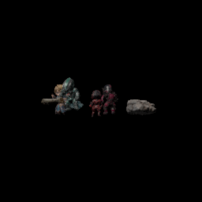

# ARE SoftwareGPU Engine

## Neu: SpherePop/CAG-Wellenfront und echte CPU-Benchmarks (20.10.2026)

**Experimentell und CPU-only:** CAG liefert den Ausbreitungsursprung, die SpherePop-inspirierte Wellenfront besucht jede Renderfläche innerhalb eines Aufrufs **genau einmal** und weist weitere Ankünfte auf bereits abgeschlossene Flächen ab. Der Doppler-Farbeffekt ist getrennt optional; eine Variante **ohne Doppler** wird in der nativen Regression verglichen. Keine vollständige originale SpherePop-Semantik, kein Audio-Doppler, kein produktiver Standard und keine GPU-Parität.

**Neue, 15-fach gepaarte Messungen** aus dem SHA-/Compiler-/Framebuffer-gebundenen [PR #128](https://github.com/OuroborosCollective/ARE-SOFTWAREGPU-ENGINE/pull/128): Baseline ist Python-`tiles` **mit identisch aktivierter Wellenfront**, Kandidat `native-cpp` **mit derselben Wellenfront**. Der native Renderer war in allen vier Fällen schneller.

| Getestete Szene | Native C++ / Tiles, beide mit SpherePop+Doppler | Status |
| --- | ---: | --- |
| 8 große Dreiecke, **64 × 64 px** | **5,06×** | 15 gepaarte CPU-Draws, RGB-/Depth-Parität zwischen Backends |
| Prozedural 400 Dreiecke, **64 × 64 px** | **4,05×** | 15 gepaarte CPU-Draws |
| Prozedural 400 Dreiecke, **32 × 32 px** | **3,25×** | 15 gepaarte CPU-Draws |
| 8 große Dreiecke, **32 × 32 px** | **3,18×** | 15 gepaarte CPU-Draws |

**Wichtig:** Die Wellenfront inklusive Doppler kostet selbst zusätzliche CPU-Zeit. Die Faktoren vergleichen die **drei Renderer bei jeweils aktivem Effekt**, nicht SpherePop gegen kein SpherePop und nicht die älteren 128/256-px-Rekorde. Wiederholung und Runner-Streuung ändern Zahlen; keine universelle FPS-Zusage. [Rohzeiten + Quellhashes](evidence/spherepop-wave-ranked-cpu-20261020.json) · [A/B-Methodik](docs/SPHEREPOP_CAG_WAVE_RANKED_BENCHMARK.md) · [PR #127 Wellenkern](https://github.com/OuroborosCollective/ARE-SOFTWAREGPU-ENGINE/pull/127).

**Neue Ablation ohne Doppler (Forschung):** Der eigenständige `native/raster/spherepop_no_doppler_test.cpp` prüft, dass Fläche, Ereignisfolge, Ankunftszeit und Einmal-Abschluss erhalten bleiben, während die unveränderten RGBA8-Pixel ohne Farbfilter gerendert werden. 15 echte native CPU-Zeitpaare vergleichen ausschließlich die Wellenverarbeitung mit/ohne Doppler; die so gemessenen Werte sind **kein voller Frame-Speedup**. Ergebnisse werden nur mit erfolgreicher CI-Evidence als gültig übernommen.


## Beste belegte CPU-Ergebnisse — Spitzenwerte zuerst

**Rekordtafel (15.10.2026):** Absteigend nach dokumentiertem Faktor sortiert. **Jede Zeile hat eine andere Referenz und teilweise eine andere Pipeline**; die Faktoren sind nicht direkt vergleichbar oder multiplizierbar. **Keine Hardware-GPU-Parität und keine allgemeine FPS-Zusage.** Forschungsvarianten sind nicht automatisch Produktionsstandard.

| Beschleunigung | Exakter CPU-gegen-CPU-Vergleich | Rahmen und Status | Nachweis |
| ---: | --- | --- | --- |
| **9,91×** | Opt-in `tiles-deferred` gegen Python-`tiles` (inkl. Batch-Shading) | **Forschung**, 5 Ebenen, hinten zuerst, 96 × 96, 2 Worker, 15 gepaarte A/B/C-Läufe, bytegleiche RGBA-/Float32-Depth-Puffer; isoliert gegen Batch-first **1,37×** | [PR #81](https://github.com/OuroborosCollective/ARE-SOFTWAREGPU-ENGINE/pull/81) · [Drei-Wege-CI](https://github.com/OuroborosCollective/ARE-SOFTWAREGPU-ENGINE/actions/runs/38613727974) |
| **8,40×** | Optionales `tiles-deferred` gegenüber `tiles` (Sichtbarkeits-Resolve **und** Batch-Shading) | **Forschung**, 5 überlappende Ebenen, 96 × 96, 2 Worker, 15 gepaarte A/B-Läufe; RGBA8 und Float32-Depth bytegleich | [PR #73](https://github.com/OuroborosCollective/ARE-SOFTWAREGPU-ENGINE/pull/73) · [CI-Receipt](https://github.com/OuroborosCollective/ARE-SOFTWAREGPU-ENGINE/actions/runs/38486619789) |
| **8,14×** | Opt-in `tiles-deferred` gegenüber Python-`tiles` (Sichtbarkeits-Resolve **und** Batch-Shading) | **Forschung**, 5 Ebenen, hinten zuerst, 96 × 96, 2 Worker, 15 gepaarte A/B/C-Läufe, RGBA8-/Float32-Depth-Parität; gegenüber Batch-first **1,42×** | [PR #81](https://github.com/OuroborosCollective/ARE-SOFTWAREGPU-ENGINE/pull/81) · [Final-Tree-CI und Artefakt](https://github.com/OuroborosCollective/ARE-SOFTWAREGPU-ENGINE/actions/runs/38655499964) |
| **7,00×** | Natives C++17-`native-cpp` gegenüber Python/NumPy-`batch-first` | Separater VertexColor-Rastertest, 13.312 Dreiecke, 256 × 256; gepaarter Median, **kein PBR-Test** | [Native-Raster-Receipt](evidence/native-raster-v1.json) · [Methodik](docs/BIO_RENDERER_PERFORMANCE_EVIDENCE.md) |
| **5,55×** | Optionales `tiles-deferred` gegenüber `tiles` (Sichtbarkeits-Resolve **und** Batch-Shading) | **Forschung**, 1 Ebene, 96 × 96, 2 Worker, 15 gepaarte A/B-Läufe; RGBA8 und Float32-Depth bytegleich | [PR #73](https://github.com/OuroborosCollective/ARE-SOFTWAREGPU-ENGINE/pull/73) · [CI-Receipt](https://github.com/OuroborosCollective/ARE-SOFTWAREGPU-ENGINE/actions/runs/38486619789) |
| **2,777×** | Frühere native Modellvariante gegenüber ihrer nativen Modell-Baseline | `AREMDL01/02 all9`, **diagnostisches Modelllicht, kein aktueller PBR-Benchmark** | [Modell-Receipt](evidence/model-repeatability-v1.json) · [Einordnung](docs/BIO_RENDERER_PERFORMANCE_EVIDENCE.md) |
| **1,73×** | Optionaler LLVM-Tile-JIT gegenüber historischem Band-Renderer | Bestwert aus getrennten festen CPU-CI-Fixtures, keine allgemeine Runtime-Aussage | [Benchmarks und Grenzen](docs/RENDER_OPTIMIZATION_EVIDENCE.md) |
| **1,709×** | Nativer Bio-PBR gegenüber nativer PBR-Baseline | `AREMDL03 arena6`, Originalmodell-Szene, 15 gepaarte Frames, volle RGBA-/Depth-Parität | [PBR-Rohbeleg](evidence/native-pbr-20261013-fixed/benchmark/benchmark.json) · [Methodik](docs/BIO_RENDERER_PERFORMANCE_EVIDENCE.md) |

**CPU-Shader-Funktionsrekorde (17.10.2026, getrennt von Gesamtbild-/Renderer-FPS):** VertexColor scalar **2,80×** (15/15 schnellere Paare), Blinn-Phong-Kanal-Clamp **2,38×** (15/15), VertexColor batch **1,15×** (13/15) gegenüber ihren jeweiligen vorherigen Python/NumPy-Funktionen. Die Messungen gelten **nur für diese Mikroworkloads**; daher stehen sie nicht in der obigen Renderer-Rekordtabelle. Alle drei Funktionen haben numerische RGBA-Paritätstests bestanden, die Renderer zusätzlich bytegleiche RGBA8-/Float32-Depth-Vergleiche. [Shader-Hotpath-Methodik](docs/SHADER_HOTPATH_PERFORMANCE_EVIDENCE_2026-10-17.md) · [GitHub-CPU-Messung](https://github.com/OuroborosCollective/ARE-SOFTWAREGPU-ENGINE/actions/runs/39049231969).

**Drei-Wege-Ablation (finaler PR-#81-Code-Tree):** Der ältere 8,40×-Vergleich enthält Batch-Shading und Visibility. Gegen den gesonderten Batch-first-Kontrollpfad erreicht die Deferred-Variante bei fünf verdeckenden Ebenen mit Far-first-Reihenfolge **1,42×** (14/15 schnellere Paare), bei einer Ebene **1,03×** (10/15) und bei fünf Ebenen Near-first **0,91×** (5/15; damit langsamer). Der direkte Vergleich mit Python-`tiles` erreicht in den drei Szenen **8,14×**, **4,85×** bzw. **2,53×**. Es handelt sich um CPU-Ratios aus 15 gepaarten Läufen auf demselben CI-Host, nicht um allgemeine Aurion-, PBR- oder Hardware-GPU-FPS. [Finaler Drei-Wege-Receipt](https://github.com/OuroborosCollective/ARE-SOFTWAREGPU-ENGINE/actions/runs/38655499964) (Artefakt 11936841063, SHA256 56ed63e4647ab9cb9af49f677b713eb8d84fde42a47ba8201bd1b861672b6a42). **Historisch:** Ein früherer Run auf Revision `9139a99` ergab 9,91× gegen `tiles`, 1,37× gegen Batch-first und 1,02× Near-first; diese Zahlen stammen ausdrücklich **nicht** vom final gemergten Code-Tree. [Frühere Messung](https://github.com/OuroborosCollective/ARE-SOFTWAREGPU-ENGINE/actions/runs/38613727974).

**Spitzenwert im Forschungsprototyp:** Bei fünf überlappenden Ebenen sank der Median im CPU-Test von **303,66 auf 36,16 ms**; bei einer Ebene von **61,80 auf 11,14 ms**. Dieses 96 × 96-Pixel-Synthetikszenario isoliert nicht den Visibility-Anteil vom Batch-Effekt und beweist **weder Aurion- noch PBR-Beschleunigung**. [Finale PR-Head-Prüfung](https://github.com/OuroborosCollective/ARE-SOFTWAREGPU-ENGINE/actions/runs/38486880187).

**Regel für neue Ergebnisse:** Nur echte, quellengebundene Messungen mit explizitem Vergleich, Rechenumgebung, Bild-/Depth-Parität und verlinkter Evidence oben eintragen; **absteigend nach belegt gemessenem Faktor**, mit Forschungs-/Produktionsstatus. Nicht unabhängig reproduzierte oder widerlegte Werte nicht zu Rekorden erklären.

> **CPU-first Software-Rasterisierung, reproduzierbare Grafiktests und experimentelle Compute-Kernels – ohne dedizierte GPU.**
>
> **English subtitle:** A CPU-only software renderer and graphics-compute research engine with tiled rasterization, optional LLVM JIT and reproducible benchmarks.

**Entwickelt von OuroborosCollective · SoftwareGPU 1.2.0 · Source-available, nichtkommerziell**

[](https://github.com/OuroborosCollective/ARE-SOFTWAREGPU-ENGINE/actions/workflows/cpu-regressions.yml) [](https://github.com/OuroborosCollective/ARE-SOFTWAREGPU-ENGINE/actions/workflows/android-gradio-apk-release.yml)

[GitHub-Releases (Verfügbarkeit prüfen)](https://github.com/OuroborosCollective/ARE-SOFTWAREGPU-ENGINE/releases) · [Visualisierung und Belege](docs/SHOWCASE.md) · [Release-Status](docs/RELEASE_STATUS.md) · [Erste Schritte](docs/QUICKSTART.md) · [Architektur](software_gpu/docs/ARCHITECTURE.md) · [Benchmarks & Evidence](docs/RENDER_OPTIMIZATION_EVIDENCE.md) · [Lizenz](LICENSE.md) · [Namensnennung](NOTICE) · [Kommerzielle Nutzung](docs/LICENSING.md)



*Original-Arena: archivierte echte CPU-Renderstichprobe, kein Live-Video, keine GPU-Parität und kein 60-FPS-Nachweis. [Bild- und Benchmark-Evidence](docs/native-pbr-arena-report-20261013.md).*

## Try it / Schnell ausprobieren

**English:** ARE SoftwareGPU is a source-available, CPU-only graphics research engine. It includes deterministic tile rasterization, optional LLVM JIT, a bounded native C++17 model/PBR research path and reproducible frame/depth evidence. It is **not** a CUDA, Vulkan, DirectX or hardware-GPU replacement. See the [English/German project overview](docs/PROJECT_OVERVIEW.md) and [real render showcase](docs/SHOWCASE.md).

**Für Neugierige:** [Echte Renderstichprobe](docs/SHOWCASE.md) · [Originalmodell-/PBR-Messbericht](docs/native-pbr-arena-report-20261013.md) · [Python-Schnellstart](docs/QUICKSTART.md) · [Releases](https://github.com/OuroborosCollective/ARE-SOFTWAREGPU-ENGINE/releases) · [Probleme und Ideen melden](https://github.com/OuroborosCollective/ARE-SOFTWAREGPU-ENGINE/issues) · [Projekt vorstellen / Share this project](docs/SHARE_THE_PROJECT.md).

**Release-Hinweis:** Ein [verifiziertes Android-/Linux-/Windows-/npm-Prerelease für Commit `14e7a3f`](https://github.com/OuroborosCollective/ARE-SOFTWAREGPU-ENGINE/releases/tag/gradio-android-14e7a3f39dbf06c61c0e9ae33fb4f41b5ed4d990) enthält sechs echte Assets; ältere Release-Fehler sind historisch. Künftige Builds und Releases müssen jeweils gesondert geprüft werden. Android/Linux/Windows/npm-Clients sind **Remote-Gradio-Clients**, keine installierten nativen Renderer. Ein erfolgreiches Release ist erst mit realen Assets und Registry-Readback belegt. [Aktueller Release-Status](docs/RELEASE_STATUS.md).

## Was ist das?

ARE SoftwareGPU Engine ist ein eigenständiges **CPU-basiertes Grafik- und Compute-Forschungsprojekt**. Es rendert Dreiecke in einen Software-Framebuffer, berechnet Tiefen- und Deckungsmasken, verarbeitet ausgewählte Bildfilter und führt deterministische Vergleichstests aus – auch auf Systemen ohne dedizierte Grafikkarte.

Das Projekt simuliert ausgewählte GPU-nahe Konzepte in Software. **Es ist kein GPU-Gerätetreiber und kein kompatibler Ersatz für DirectX 11, CUDA, Vulkan oder das Training großer Sprachmodelle.** Die vorhandenen Direct3D-/CUDA-artigen Schnittstellen sind experimentelle Python-Adapter. Ein optionaler C++17-Raster- und Modellpfad sowie ein lokaler Gradio-Renderclient sind getrennte Implementierungen und keine Hardware-GPU.

## Funktionen und Nachweisstand

| Bereich | Implementierung | Nachweisgrenze |
| --- | --- | --- |
| Rendering | Software-Framebuffer, Depth-Test, Triangle-Binning und Tile-Rasterisierung | CPU-Bildvergleich auf Linux/Windows |
| Beschleunigung | NumPy-Tiles sowie optionaler Numba/LLVM-JIT für Coverage und Tiefentest | Keine garantierte SIMD-ISA oder GPU-Beschleunigung |
| Kantenglättung | 4× MSAA-Resolve und FXAA | Testbilder/Regression, kein DirectX-Konformitätstest |
| Bildbearbeitung | HDR/Bloom, Tone-Mapping und Filter-Demos | Experimentelle Pipeline |
| Compute | NumPy-Matrixoperationen, Generator-SIMT und Schwarm-Demos | Kein CUDA-Treiber, keine PyTorch-GPU-Anbindung |
| Schnittstellen | HTTP/TCP-Prototyp und Beispielclients verschiedener Sprachen | **Nicht für öffentliche Netze freigegeben** |
| Native C++17-Pipeline | Optionaler CPU-Rasterizer, perspektivisches GLB-Subset (AREMDL03), Metallic-Roughness/PBR | Byte-Paritäts- und Originalmodell-Evidence; kein Vulkan-/GPU-Backend, kein allgemein vollständiger glTF-Importer |
| Gradio | Passwortgeschützte lokale Vorschau, echte isolierte CPU-Jobs/Receipts | Loopback-HTTP-Livetest in CI, kein öffentlich gehosteter Server bestätigt |
| Android/Node-Clients | Debug-APK, Linux-/Windows-Node-Launcher und npm-Tarball im Release-Workflow | Kein Android-Gerätetest und kein eingebetteter Renderer; Veröffentlichung nur nach Registry-/Release-Readback |
| Plattformen | GitHub-CI für Linux und Windows, Python 3.11/3.12 | Android-WebView-/Desktop-Clients gesondert und ohne Gerätelaufzeitnachweis |

### Gemessene Verbesserung

**Unser nativer Bio-Renderer ist messbar schneller als seine native Referenz:** AREMDL03-PBR erreichte **1,587×** (`animated4`), **1,554×** (`static2`) und **1,709×** (`arena6`) in 15 gepaarten CPU-Frame-Messungen je Szene mit voller RGBA-/Depth-Parität. Im **getrennten** C++17-VertexColor-Rastertest erreichte `native-cpp` **7,00×** gegenüber dem Python/NumPy-`batch-first`-Backend bei 13.312 statischen Dreiecken/256 px. Das ist **kein** direkter Bio-PBR-gegen-NumPy-PBR-Vergleich, kein GPU-Nachweis und keine allgemeine FPS-Zusage. [Vergleichstabellen, Rohreceipts und Geltungsgrenzen](docs/BIO_RENDERER_PERFORMANCE_EVIDENCE.md).

In drei festen CPU-CI-Fixtures wurden die neuen Tiles gegenüber dem historischen Band-Renderer **1,51–1,57×** schneller gemessen, mit optionalem JIT **1,65–1,73×** (separate Runner-Konfigurationen). Die Vergleichsbilder waren in diesen Läufen farbgleich; es gab keine Tiefenabweichung. Diese Zahlen sind **keine** generelle Leistungszusage. [Messaufbau und Grenzen](docs/RENDER_OPTIMIZATION_EVIDENCE.md).

## Schnellstart

Voraussetzung: Python 3.11 oder 3.12 und ein CPU-System.

```bash
python -m pip install -e .
software-gpu --help
software-gpu --info
python -m unittest discover -s software_gpu/tests -v
```

Optionaler CPU-LLVM-Kern und Benchmark:

```bash
python -m pip install -e ".[jit]"
python -m software_gpu.benchmarks.compare_tile_backends --workers 2 --repeats 3 --jit
```

Renderausgaben lassen sich mit `ARE_SOFTWAREGPU_OUTPUT_DIR` in ein eigenes Verzeichnis schreiben. Der experimentelle `--server` ist auf Loopback beschränkt und benötigt einen expliziten Bearer-Token; eine öffentliche TLS-/Mehrmandantenfreigabe ist **nicht** nachgewiesen. [Details](docs/SECURITY_AND_LIMITS.md).

## Projektstruktur

```text
software_gpu/core/          CPU-Gerätemodell, Speicher, Output und VPS-Governor
software_gpu/compute/       Generator-SIMT und NumPy-Compute
software_gpu/graphics/      Renderer, Framebuffer, Tile/LLVM und Postprocessing
software_gpu/benchmarks/    Reale CPU-Benchmarks und Vergleichs-Fixtures
software_gpu/network/       Experimentelle HTTP/TCP-Protokolle
software_gpu/clients/       Sprachübergreifende Prototypen
software_gpu/mobile/        Experimentelle Android-/OpenGL-ES-Adapter
software_gpu/integrations/  Blender-, Image- und MMORPG-Beispiele
software_gpu/tests/         Unit- und Regressionstests
native/symbolic/            C++17-Modell-/PBR- und Workrooms-Forschung
reference_arena/            Three.js-Visualreferenz (GLBs lokal nach Manifest)
plugins/gradio_arena/       Optionales privates Gradio-Frontend
clients/node/               Node-CLI zur HTTPS-Gradio-Instanzprüfung
android/                    Android-WebView-Begleitapp (Debug-Build)
.github/workflows/          CI-/APK-/Node-Release-Automation
docs/                       Lizenzleitfaden, Sicherheit, Evidenz, Aurion-Grenzen
```

Die vollständige Architektur, Grenzen und Beispielabläufe stehen in der [technischen Dokumentation](software_gpu/docs/ARCHITECTURE.md). Die ursprünglichen Quellbehauptungen sind zu Herkunftszwecken getrennt in [docs/UPSTREAM_README.md](docs/UPSTREAM_README.md) archiviert und **nicht automatisch verifiziert**.

## Lizenz und Namensnennung

**Copyright (c) 2026 OuroborosCollective.**

Dieses Projekt steht, soweit die Rechte bei den genannten Rechteinhabern liegen, unter der **[PolyForm Noncommercial License 1.0.0](LICENSE.md)** (`PolyForm-Noncommercial-1.0.0`).

- **Nichtkommerziell:** Verwenden, untersuchen, ändern und unter den Lizenzbedingungen weitergeben.
- **Namensnennung:** Bei Weitergabe den [verpflichtenden Rechtehinweis](NOTICE) und die Lizenz bzw. ihren offiziellen Link mitgeben. Empfohlene sichtbare Quellenangabe: „Based on ARE SoftwareGPU Engine by OuroborosCollective“.
- **Kommerziell:** Nur mit **separater vorheriger schriftlicher Vereinbarung** mit den zuständigen Rechteinhabern; die öffentliche Lizenz erteilt diese Erlaubnis nicht.

Die Lizenz ist **source-available, nicht OSI-zertifiziertes Open Source**. Rechte an Drittkomponenten bleiben unberührt. Anfragen für kommerzielle Lizenzierung: [Lizenzleitfaden](docs/LICENSING.md). Beiträge: [CONTRIBUTING.md](CONTRIBUTING.md).

## Aurion: bewusst isoliert

Eine eventuelle Verwendung bei Echoes of Aurion ist nur als **read-only Offline-Render-/Benchmark-Worker** vorgesehen. Es gibt **keine** Liveintegration in die kanonische Spielwelt, Physik-Autorität oder 100-ms-Ticksteuerung. [Schnittstellenvertrag](docs/AURION_OFFLINE_ADAPTER_CONTRACT.md).

[Projektstatus und CI-Evidence](PROJECT_STATUS.md) · [Projektüberblick (DE/EN)](docs/PROJECT_OVERVIEW.md)

## MIHA CPU training integration

[Workflow, runner requirements and outputs](docs/MIHA_CPU_TRAINING.md): pinned Hugging Face CPU-LoRA training with canonical/Atomic readback, unchanged 16-GiB and longest-example gates, real training-loss charts, checkpoints and optional candidate upload. Open the generated `training_metrics.html` for a readable chart and exact observations. ARE SoftwareGPU renders metrics on CPU; tensor training remains in CPU PyTorch.

## Experimenteller Flächenplaner

Der ausdrücklich wählbare Backend-Pfad `tiles-plan` ergänzt Flächenklassifikation,
deklarierte Vertex-Color-Batch-Shader und einen vierfarbigen Graph-Nachweis.
Standard bleibt `tiles`; kleine Primitive können auf den Referenzpfad zurückfallen.
[Bedienung, Verträge und Grenzen](docs/SURFACE_PLANNER.md).

```bash
python -m software_gpu.benchmarks.compare_surface_plans --output-dir surface-plan-results --repeats 15 --pixels 256 --ablation
```

Die [SoftwareGPU Workbench](plugins/softwaregpu-workbench/README.md) enthält
das wiederverwendbare Plugin für echte Regressionen, begrenzte Benchmarks,
Quellhash-Audit, Ablationsanalyse, Renderer-Kalibrierung und CPU-Finetuning-Preflight.
